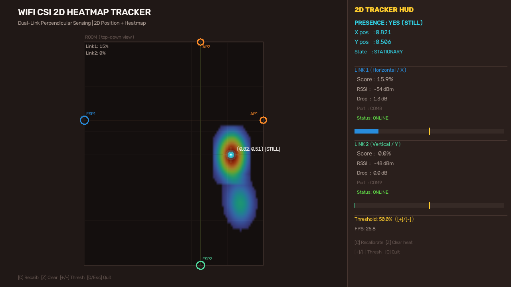
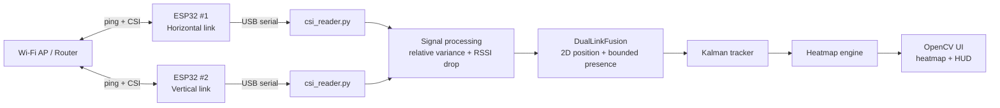

# 📡 WiFi CSI — Human Sensing & 2D Tracking

**Contactless presence detection, coarse 2D tracking and people counting using Wi-Fi Channel State Information (CSI) with two ESP32 boards.**

[](https://www.python.org/)
[](https://opencv.org/)
[](https://scikit-learn.org/)
[](#-quick-start)
[](LICENSE)
[](#-roadmap)

> **بالعربي:** نظام كشف وتتبّع الأشخاص بدون كاميرا باستخدام إشارات الواي فاي (CSI) عبر جهازَي ESP32، مع خريطة حرارية 2D وعدّاد أشخاص. الدليل العربي الكامل في [`CSI/README.md`](CSI/README.md)، والشرح التقني المفصّل في [`PRESENTATION_DOCUMENTATION.md`](PRESENTATION_DOCUMENTATION.md).



---

## 📑 Table of Contents

- [Overview](#-overview)
- [Features](#-features)
- [How It Works](#-how-it-works)
- [Architecture](#-architecture)
- [Hardware](#-hardware)
- [Quick Start](#-quick-start)
- [Real Hardware Setup](#-real-hardware-setup)
- [Firmware & Credentials](#-firmware--credentials)
- [Project Structure](#-project-structure)
- [Configuration](#-configuration)
- [Machine Learning](#-machine-learning)
- [Evaluation & Honest Results](#-evaluation--honest-results)
- [Limitations](#-limitations)
- [Troubleshooting](#-troubleshooting)
- [Roadmap](#-roadmap)
- [Documentation](#-documentation)
- [License](#-license)

---

## 🔍 Overview

Wi-Fi signals fill every room. When a human body moves through them, the
**Channel State Information (CSI)** — the amplitude and phase of every OFDM
subcarrier — changes in a measurable way. This project turns two ESP32 boards
into a **camera-free sensing system**:

- **Presence** — is someone in the room?
- **2D position** — a smoothed `(x, y)` estimate drawn on a live heatmap.
- **People count** — an OpenCV blob estimate from the accumulated heatmap.
- **Optional ML** — a Random Forest occupancy estimator (auxiliary by default).

The two boards are placed on **perpendicular links**, so one link is sensitive
to horizontal movement and the other to vertical movement. Fusing them gives a
coarse 2D position instead of a single 1D left/right estimate.

---

## ✨ Features

| Feature | Description |
|---|---|
| 📡 **Dual-link 2D fusion** | Two perpendicular ESP32 ↔ AP links fused into `(x, y)` |
| 🔥 **Live heatmap** | Accumulated occupancy map with temporal decay and Gaussian blobs |
| 🟢 **Kalman smoothing** | Stable, low-jitter dot with velocity clamping and a deadband |
| ⏳ **Bounded presence** | Motion keeps presence alive; a grace window (default 10 s, ×2 with a body shadow) then clears it — empty rooms always return to `NO` |
| 👥 **People counting** | OpenCV contours/blobs; ML is optional and never overrides by default |
| 🎛️ **Config-driven tuning** | Thresholds, hold time, Kalman, heatmap and smoothing in `config.json` |
| 🖥️ **Two apps** | 2D heatmap tracker + oscilloscope-style scope/people counter |
| 🧪 **Demo mode** | Full simulation with no hardware (`--demo`) |
| 🔌 **Auto-reconnect** | Serial reader reopens the port if a board is unplugged |
| 🧾 **Robust parser** | Accepts comma-separated and legacy space-separated CSI payloads |
| 🔐 **No secrets in Git** | Wi-Fi credentials live in gitignored `secrets.h` |

---

## ⚙️ How It Works

1. **Capture** — each ESP32 pings the access point; the AP replies and the board
   prints one `CSI_DATA` line per packet over USB serial (≈25 Hz).
2. **Parse** — `csi_reader.py` decodes the CSI array and computes the amplitude
   `√(imag² + real²)` for every subcarrier.
3. **Analyse** — `LinkEngine` tracks the relative subcarrier variance and the
   RSSI drop, then produces a 0–100 % activity score per link.
4. **Fuse** — `DualLinkFusion` maps the two scores to a 2D position and decides
   presence using motion **or** a bounded post-motion grace window.
5. **Smooth** — a Kalman filter stabilises the trajectory; velocity clamping and
   a deadband remove teleporting and micro-jitter.
6. **Render** — `HeatmapEngine` accumulates a decaying occupancy map; OpenCV
   draws the heatmap, the person dot, the trail and the HUD.

---

## 🏗️ Architecture



---

## 🧰 Hardware

| Component | Notes |
|---|---|
| **2 × ESP32 DevKit v1** | Any classic ESP32 with Wi-Fi |
| **1 × 2.4 GHz access point / phone hotspot** | ESP32 does **not** support 5 GHz |
| **USB cables + CP2102/CH340 drivers** | One per board |
| **PC** | Python 3.10–3.12, Windows/Linux/macOS |

> ⚠️ Python 3.14 may not have pre-built OpenCV wheels yet. Use **3.11 or 3.12**
> for the smoothest install.

---

## 🚀 Quick Start

### 1. Clone and install

```bash
git clone https://github.com/saifadel20071234-sudo/Wi-FI-csi-main.git
cd Wi-FI-csi-main

python -m venv CSI/.venv
# Windows:
CSI\.venv\Scripts\activate
# Linux / macOS:
source CSI/.venv/bin/activate

pip install -r CSI/requirements.txt
```

### 2. Run the demo (no hardware)

```bash
python CSI/src/dual_link_tracker.py --demo
```

Or double-click **`run_tracker_demo.bat`** (Windows). A simulated person walks
around the room for 33 s, then the room is empty for 12 s so you can watch
presence clear back to `NO`.

```bash
# Oscilloscope + people counter demo
python CSI/src/scope_monitor.py --demo
```

### 3. Run with real hardware

```bash
python CSI/src/dual_link_tracker.py --port1 COM8 --port2 COM9
```

Or set the ports once in `CSI/config.json` and simply run:

```bash
python CSI/src/dual_link_tracker.py
```

Useful flags:

| Flag | Meaning |
|---|---|
| `--demo` | Simulated 2D movement, no hardware |
| `--port1 / --port2` | Serial ports of the two boards |
| `--threshold` | Presence threshold (0–100) |
| `--hold` | Seconds presence is kept after motion stops |
| `--shadow` | RSSI drop (dB) treated as a static body shadow |
| `--no-gui` | Console-only mode |
| `--seconds` | Auto-stop after N seconds |
| `--config` | Alternative `config.json` path |

### Controls (GUI)

| Key | Action |
|---|---|
| `C` | Recalibrate baseline — keep the room empty |
| `Z` / `R` | Clear the heatmap / reset |
| `+` / `-` | Adjust the detection threshold |
| `Q` / `Esc` | Quit |

---

## 🔧 Real Hardware Setup

1. **Flash the firmware** — Arduino sketches live in
   [`CSI/firmware_arduino/`](CSI/firmware_arduino/README.md); the ESP-IDF version
   lives in [`CSI/firmware/`](CSI/firmware/README.md).
2. **Place the boards** — put the AP at a fixed spot, then place ESP32 #1 and
   ESP32 #2 so their links are roughly **perpendicular** and both cross the
   area of interest (keep > 1 m from the AP).
3. **Set the ports** — edit `devices[].port` in `CSI/config.json`, or pass
   `--port1/--port2`. List ports with:
   ```bash
   python CSI/src/main.py --list-ports
   ```
4. **Calibrate** — start the app with the room empty for ~3 s, then walk
   around. Press `C` any time the environment changes.

---

## 🔐 Firmware & Credentials

Wi-Fi credentials are **no longer hard-coded**. Each Arduino sketch includes a
local, gitignored `secrets.h`:

```bash
cd CSI/firmware_arduino/csi_scope_esp32
copy secrets.h.example secrets.h     # Windows
# cp secrets.h.example secrets.h     # Linux / macOS
```

Then edit:

```c
const char* PRIMARY_SSID = "YOUR_SSID";
const char* PRIMARY_PASS = "YOUR_PASSWORD";
```

Repeat for `csi_scope_esp32_2/`. See
[`CSI/firmware_arduino/README.md`](CSI/firmware_arduino/README.md) for the
serial payload format.

> 🔒 `secrets.h` is ignored by Git. Never commit real credentials. If they were
> ever committed, rotate the password — removing them from Git history requires
> a rewrite.

---

## 📁 Project Structure

```text
.
├── README.md                     # This file (English)
├── README.ar.md                  # Arabic guide
├── LICENSE                       # MIT
├── CHANGELOG.md                  # Notable changes
├── PRESENTATION_DOCUMENTATION.md # Deep technical + presentation guide (Arabic)
├── run_*.bat                     # Windows one-click launchers
└── CSI/
    ├── config.json               # Room, devices, processing, tracker tuning
    ├── requirements.txt
    ├── src/
    │   ├── dual_link_tracker.py  # 2D heatmap tracker (dual-link)
    │   ├── main.py               # Single/RTI pipeline + console/GUI
    │   ├── scope_monitor.py      # Oscilloscope + people counter
    │   ├── csi_reader.py         # Serial reader, parser, auto-reconnect
    │   ├── processor.py          # Presence / motion / direction / count
    │   ├── occupancy.py          # Heatmap + OpenCV blob detection
    │   ├── rti.py                # Radio tomographic imaging (3+ devices)
    │   ├── kalman.py             # Kalman tracker
    │   ├── count_model.py        # Random Forest feature extractor/predictor
    │   ├── simulator.py          # Demo source
    │   ├── visualizer.py         # OpenCV visualizer
    │   └── config.py             # Config loading + port helpers
    ├── firmware/                 # ESP-IDF firmware + guide
    ├── firmware_arduino/         # Arduino sketches + secrets.h.example
    ├── assets/tracker_preview.png
    ├── train_count_model.py      # Train / validate the count model
    ├── collect_count_data.py     # Collect labeled feature windows
    ├── count_data.csv            # Sample labeled data
    └── extracted_research/       # Evaluation scripts, results, reports
```

---

## 🎛️ Configuration

All tracker tuning lives in `CSI/config.json` → `tracker`:

| Key | Default | Meaning |
|---|---|---|
| `threshold` | `50.0` | Activity % required to count as motion |
| `stationary_hold_sec` | `10.0` | Grace window after the last motion |
| `static_shadow_db` | `1.5` | RSSI drop treated as a static body (doubles the window) |
| `calibration_seconds` | `3.0` | Empty-room calibration time |
| `smoothing_alpha` | `0.35` | Position smoothing |
| `max_step` | `0.065` | Max normalised step per frame (anti-teleport) |
| `deadband` | `0.016` | Minimum movement before updating the dot |
| `heat_decay` | `0.978` | Heatmap temporal decay |
| `heat_intensity` | `16.0` | Heatmap deposit strength |
| `kalman_process_noise` | `0.10` | Kalman `Q` |
| `kalman_measurement_noise` | `0.001` | Kalman `R` |

CLI flags (`--threshold`, `--hold`, `--shadow`) always override the config file.

The `processing` section also controls the ML behaviour:

| Key | Default | Meaning |
|---|---|---|
| `count_ml_override` | `false` | Let ML replace the blob count |
| `count_ml_confidence_min` | `0.6` | Minimum model confidence for an override |

---

## 🧠 Machine Learning

`count_model.py` builds a fixed 11-feature vector per window (activity mean/std/max
and RSSI-drop mean per device, plus totals and presence rate) and a
`RandomForestClassifier` predicts the number of people.

Train it with:

```bash
# Synthetic sanity check
python CSI/train_count_model.py --synthetic

# Real labeled data (collect with --count 0/1/2 first)
python CSI/collect_count_data.py --count 1 --seconds 60
python CSI/train_count_model.py --csv CSI/count_data.csv
```

Safety behaviour:

- The training script **refuses to overwrite** the model when all rows share one
  label (a single-class model is useless).
- Legacy CSVs with different feature names (e.g. `left_*`/`right_*`) are mapped
  by column order with a warning.
- `--out-dir` lets you train into a separate folder without touching the
  shipped model.

> ⚠️ The shipped model was trained on **one-person** data only. It is therefore
> **auxiliary** and disabled as an override by default. The geometric blob count
> remains authoritative until you collect multi-class data and retrain.

---

## 📊 Evaluation & Honest Results

| Metric | Value | Note |
|---|---|---|
| Within-recording MAE | ≈ **0.72 person** | Random Forest, combined features |
| Cross-recording evaluation | **Failed** | Do **not** present this as general accuracy |
| Presence clearing | Verified | Returns to `NO` after the grace window |
| Demo run (50 s) | `YES=80`, `NO=20` | Presence cleared and stayed `NO` after the empty phase |

Detailed experiments, feature tables and error analysis are in
[`CSI/extracted_research/SUBMISSION/`](CSI/extracted_research/SUBMISSION/).

---

## ⚠️ Limitations

- **Motion-first sensing.** A perfectly still person is held for a bounded grace
  window, not detected indefinitely. Breathing-level detection needs dedicated
  processing.
- **Coarse depth.** Two links estimate left/right well; near/far is approximate.
  True 2D localisation and robust multi-person counting need **3–4 boards** or a
  trained model.
- **Environment sensitive.** Furniture, walls, other people and neighbouring
  Wi-Fi networks affect the signal.
- **Heatmap is illustrative**, not a geometric map.
- **Hardware-dependent.** CI and demo tests cannot replace a real deployment.

---

## 🐞 Troubleshooting

| Problem | Fix |
|---|---|
| `cannot open COM3` | Check the cable/driver, close other serial monitors, run `--list-ports` |
| No CSI lines | Use a 2.4 GHz network, verify `secrets.h`, confirm the board has an IP |
| Window does not appear | Install OpenCV: `pip install opencv-python` |
| Dot jitters | Increase `smoothing_alpha` / `deadband` or raise `threshold` |
| No detection | Lower `threshold`, recalibrate with `C` in an empty room |
| Presence never clears | Lower `stationary_hold_sec` / raise `static_shadow_db` |
| Dropped frames / lag | Lower `CONFIG_SEND_FREQUENCY` in the firmware and reflash |

---

## 🗺️ Roadmap

- [ ] Collect multi-class data and ship a trustworthy occupancy model
- [ ] 3–4 link RTI for true 2D localisation
- [ ] Breathing / stationary-person detection
- [ ] Web dashboard (FastAPI + WebSocket) instead of the OpenCV window
- [ ] Automated hardware-in-the-loop tests

---

## 📚 Documentation

| Document | Language | Content |
|---|---|---|
| [`README.md`](README.md) | English | Project overview and setup |
| [`README.ar.md`](README.ar.md) | العربية | الدليل العربي الكامل |
| [`PRESENTATION_DOCUMENTATION.md`](PRESENTATION_DOCUMENTATION.md) | العربية | شرح تقني وعلمي مفصّل للعرض |
| [`CSI/firmware/README.md`](CSI/firmware/README.md) | العربية | حرق فيرموير ESP-IDF |
| [`CSI/firmware_arduino/README.md`](CSI/firmware_arduino/README.md) | العربية | إعداد Arduino و`secrets.h` |
| [`CHANGELOG.md`](CHANGELOG.md) | English | Notable changes |

---

## 📄 License

Released under the **MIT License** — see [`LICENSE`](LICENSE).

---

## 🙏 Acknowledgements

- [Espressif ESP-CSI](https://github.com/espressif/esp-csi) — CSI capture firmware
- [ESP-IDF Wi-Fi CSI docs](https://docs.espressif.com/projects/esp-idf/en/latest/esp32/api-guides/wifi.html#wi-fi-channel-state-information)
- OpenCV, NumPy and scikit-learn communities

> Built as a graduation project on camera-free human sensing with Wi-Fi CSI.
